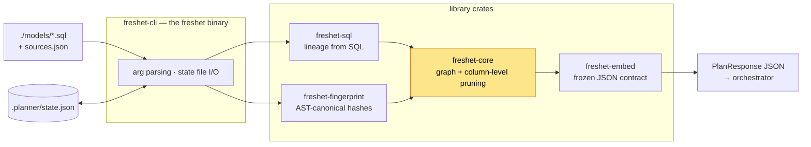
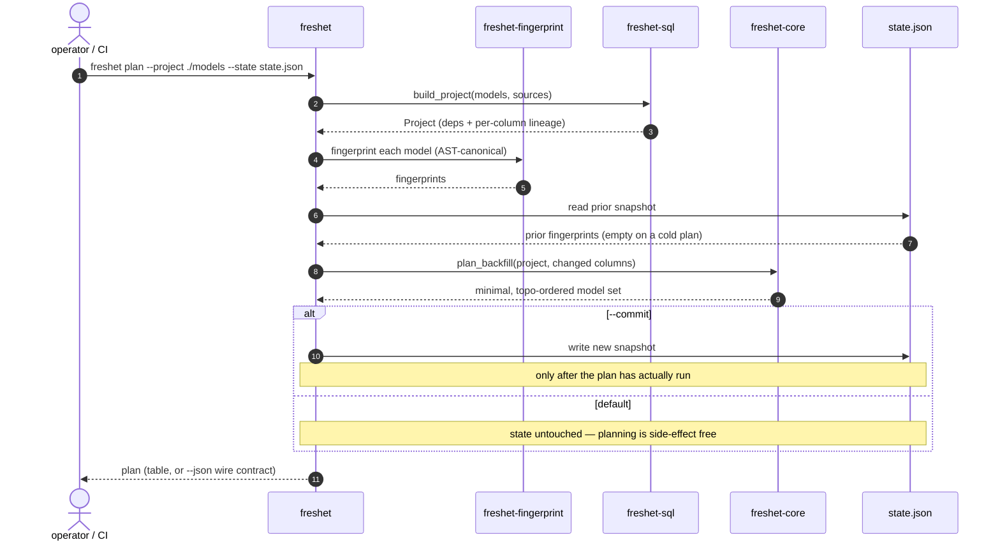

# freshet-cli — the `freshet` binary

The one-shot CLI over the Freshet planner: point it at a directory of `.sql`
models and a state file, and it tells you the **minimal** set of models a change
requires rebuilding.

The crate keeps its structural name (`freshet-cli`); the binary it produces is
`freshet`, which is the product name.

## Quickstart

```sh
mkdir -p /tmp/models
echo 'select order_id, amount, qty from raw_orders' > /tmp/models/stg_orders.sql
echo 'select order_id, amount from stg_orders'      > /tmp/models/mart_revenue.sql

# Cold plan: nothing is committed yet, so everything is new. Read-only.
freshet plan --project /tmp/models --state /tmp/state.json

# Seed the baseline. In real use `--commit` comes AFTER the plan has actually
# run (see "Commit discipline" below) — committing work that did not happen is
# what causes the next plan to under-rebuild. Here there is no orchestrator and
# nothing to execute, so seeding directly is safe and is the only reason this
# demo can show a diff on the next step.
freshet plan --project /tmp/models --state /tmp/state.json --commit

# Now change one model and ask again.
echo 'select order_id, amount * 2 as amount, qty from raw_orders' > /tmp/models/stg_orders.sql
freshet plan --project /tmp/models --state /tmp/state.json --json
```

```json
{
  "models": [
    { "name": "stg_orders", "reason": "directly_changed", "unit": "full_model" },
    {
      "name": "mart_revenue",
      "reason": { "downstream": { "because_of": "stg_orders", "via_columns": ["amount", "order_id"] } },
      "unit": "full_model"
    }
  ]
}
```

`mart_revenue` is rebuilt because it consumes a column that actually changed —
not merely because it sits downstream. That distinction is the product.

## Architecture

The CLI is a thin shell. It owns argument parsing and the state file; every
decision below that belongs to a library crate, which is what keeps the same
answers available to the C-ABI, WASM and Python bindings.



## Call flow

`plan` is two passes over the project: fingerprint everything, diff against the
committed snapshot, then prune downstream by column. The snapshot is written only
on `--commit`, which is why that flag is a separate decision from planning.



## Commands

| Command | What it answers |
|---|---|
| `freshet plan` | What must rebuild, given the change since the last commit (`--state` file or hosted URL) |
| `freshet restate` | Replan specific partitions of one model (ignores fingerprints; with `--state`, records the restatement in the ledger) |
| `freshet fingerprint` | Each model's AST-canonical hash + any text-scheme fallback |
| `freshet graph` | The project's topological model order |
| `freshet submit` | Post the plan (with its CU estimate) to a consumer that runs it; never commits |

`--json` on `plan`/`restate` emits the frozen `freshet-embed` wire contract — the
same JSON every other binding produces, and what downstream consumers read.

## Budget headroom

`plan --budget <CU>` caps a plan and reports how much room is left. It is a
guardrail a team sets **for itself** — a CI gate against a migration that would
rewrite the warehouse — not a tier limit; omit it and the plan is uncapped, which is
the default everywhere.

```sh
$ freshet plan --project ./models --budget 5
... the plan table ...

budget: 2.000 CU (2000 mCU) left of 5.000 CU (5000 mCU) — used 3.000 CU (3000 mCU) (60.0%)
        [##############----------]
```

Over the cap it still prints the plan (you cannot scope down what you cannot see),
exits non-zero, and **never commits — even with `--commit`**. That last part is the
commit discipline below applied to the quota gate: a refused plan has rebuilt
nothing, so recording it as built would be the same under-rebuild bug.

With `--json`, a `headroom` object (`cap_millicu` / `used_millicu` /
`remaining_millicu` / `exceeded`) rides along and `next_state` is **dropped** when
the cap binds. Without `--budget` there is no `headroom` key at all. Full reference:
[`docs/CONFIG.md`](../../docs/CONFIG.md#--budget-what-a-cap-does-and-what-it-refuses-to-do).

## Commit discipline

`--commit` advances the state file. Run it **only after the plan has actually
executed**, or the next plan will believe work happened that did not:

```sh
freshet plan --project ./models --state .planner/state.json --json > plan.json
# ... execute plan.json with your orchestrator, and only if it succeeded:
freshet plan --project ./models --state .planner/state.json --commit
```

Losing the state file is safe — it causes one full cold plan. Committing early is
not: it causes an under-rebuild, the bug class this tool exists to prevent. See
[`docs/OPERATIONS.md`](../../docs/OPERATIONS.md).

## Hosted state

`--state` may name a **hosted state API** instead of a file — dagron Cloud serves
one at `https://<edge>/state/v1` — with an API token in `FRESHET_STATE_TOKEN`:

```sh
export FRESHET_STATE_TOKEN=…            # a workspace token; commits need state:commit
S=https://edge.example.com/state/v1
freshet plan --project ./models --state $S --json > plan.json
# stderr: hosted state: version 7 at https://edge.example.com/state/v1
# ... execute plan.json, and only if it succeeded:
freshet plan --project ./models --state $S --commit --expect-version 7
```

It holds the same document a state file does (fingerprints + the partition ledger;
the mapping is the identity), but every commit is a **compare-and-swap**: if another
commit landed after this plan was computed, nothing is written and `freshet` exits
**3** — re-plan against what the winner recorded. `--expect-version` carries the
version `plan` printed across the plan → run → commit gap; without it, a commit
compares against the version it loads itself. `restate --state <url>` records and
settles its ledger the same way, and `submit --state <url>` reads it and never
writes. The token is read from the environment only, never from a flag or the URL,
and never printed. Reference: [`docs/CONFIG.md`](../../docs/CONFIG.md#state-a-file-or-hosted-state).

## Piping into an orchestrator

The output is designed to be piped. dagron consumes it directly:

```sh
freshet plan --project ./models --state .planner/state.json --json \
  | dagron-state explain -
```

